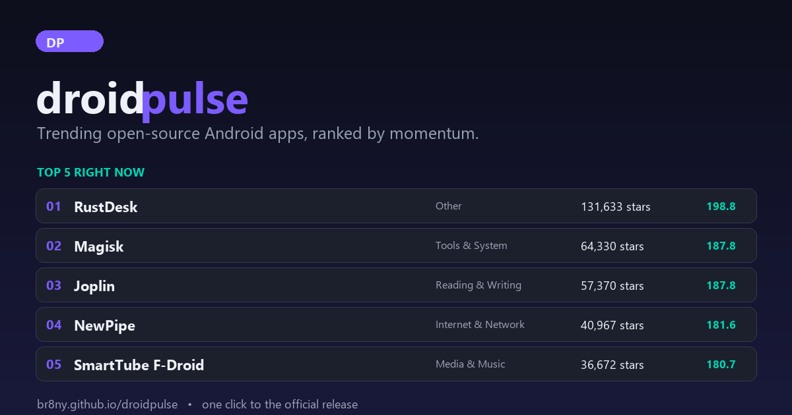

# droidpulse

**Trending open-source Android apps, ranked by momentum — one click to the official release.**

Auto-generated daily from the [F-Droid index](https://f-droid.org) and GitHub. No APKs are hosted here: every entry redirects to the project's own latest release page.

_Last updated 2026-11-26 18:29 UTC · 450 ranked apps · 4005 F-Droid apps with GitHub source_

## Overall top 25

| # | App | Category | Stars | Pulse | Release |
|---:|---|---|---:|---:|---|
| 1 | [RustDesk](https://github.com/rustdesk/rustdesk) | Other | 131,633 | 198.8 | [Download](https://github.com/rustdesk/rustdesk/releases/latest) |
| 2 | [Magisk](https://github.com/topjohnwu/magisk) | Tools &amp; System | 64,330 | 187.8 | [Download](https://github.com/topjohnwu/magisk/releases/latest) |
| 3 | [Joplin](https://github.com/laurent22/joplin) | Reading &amp; Writing | 57,370 | 187.8 | [Download](https://github.com/laurent22/joplin/releases/latest) |
| 4 | [NewPipe](https://github.com/teamnewpipe/newpipe) | Internet &amp; Network | 40,967 | 181.6 | [Download](https://github.com/teamnewpipe/newpipe/releases/latest) |
| 5 | [SmartTube F-Droid](https://github.com/yuliskov/smarttube) | Media &amp; Music | 36,672 | 180.7 | [Download](https://github.com/yuliskov/smarttube/releases/latest) |
| 6 | [Mindustry](https://github.com/anuken/mindustry) | Games | 29,986 | 176.1 | [Download](https://github.com/anuken/mindustry/releases/latest) |
| 7 | [Kazumi](https://github.com/predidit/kazumi) | Media &amp; Music | 44,167 | 174.3 | [Download](https://github.com/predidit/kazumi/releases/latest) |
| 8 | [Termux](https://github.com/termux/termux-app) | Tools &amp; System | 65,765 | 173.1 | [Download](https://github.com/termux/termux-app/releases/latest) |
| 9 | [Obtainium](https://github.com/imranr98/obtainium) | Tools &amp; System | 21,935 | 171.3 | [Download](https://github.com/imranr98/obtainium/releases/latest) |
| 10 | [Seal](https://github.com/junkfood02/seal) | Internet &amp; Network | 31,048 | 168.9 | [Download](https://github.com/junkfood02/seal/releases/latest) |
| 11 | [Organic Maps・Offline Map &amp; GPS](https://github.com/organicmaps/organicmaps) | Navigation &amp; Travel | 16,139 | 168.9 | [Download](https://github.com/organicmaps/organicmaps/releases/latest) |
| 12 | [SimpMusic](https://github.com/maxrave-dev/simpmusic) | Media &amp; Music | 13,926 | 167.1 | [Download](https://github.com/maxrave-dev/simpmusic/releases/latest) |
| 13 | [Thunderbird: Free Your Inbox](https://github.com/thunderbird/thunderbird-android) | Internet &amp; Network | 14,296 | 166.7 | [Download](https://github.com/thunderbird/thunderbird-android/releases/latest) |
| 14 | [aFreeRDP](https://github.com/freerdp/freerdp) | Internet &amp; Network | 14,058 | 166.1 | [Download](https://github.com/freerdp/freerdp/releases/latest) |
| 15 | [Unciv](https://github.com/yairm210/unciv) | Games | 11,656 | 165.0 | [Download](https://github.com/yairm210/unciv/releases/latest) |
| 16 | [Komi Store](https://github.com/komi-store/komi-store) | Tools &amp; System | 22,505 | 164.6 | [Download](https://github.com/komi-store/komi-store/releases/latest) |
| 17 | [Kodi](https://github.com/xbmc/xbmc) | Media &amp; Music | 21,548 | 164.0 | [Download](https://github.com/xbmc/xbmc/releases/latest) |
| 18 | [AnkiDroid: Flashcards](https://github.com/ankidroid/anki-android) | Education | 12,343 | 163.1 | [Download](https://github.com/ankidroid/anki-android/releases/latest) |
| 19 | [YTDLnis](https://github.com/deniscerri/ytdlnis) | Internet &amp; Network | 11,334 | 161.2 | [Download](https://github.com/deniscerri/ytdlnis/releases/latest) |
| 20 | [AntennaPod - Podcast Player](https://github.com/antennapod/antennapod) | Media &amp; Music | 8,358 | 160.2 | [Download](https://github.com/antennapod/antennapod/releases/latest) |
| 21 | [Outline](https://github.com/outlinefoundation/outline-apps) | Internet &amp; Network | 9,297 | 160.1 | [Download](https://github.com/outlinefoundation/outline-apps/releases/latest) |
| 22 | [SD Maid 2/SE - System Cleaner](https://github.com/d4rken-org/sdmaid-se) | Tools &amp; System | 8,279 | 159.5 | [Download](https://github.com/d4rken-org/sdmaid-se/releases/latest) |
| 23 | [Aegis Authenticator](https://github.com/beemdevelopment/aegis) | Privacy &amp; Security | 13,644 | 159.2 | [Download](https://github.com/beemdevelopment/aegis/releases/latest) |
| 24 | [ServerBox](https://github.com/lollipopkit/flutter_server_box) | Internet &amp; Network | 9,077 | 159.0 | [Download](https://github.com/lollipopkit/flutter_server_box/releases/latest) |
| 25 | [NewsBlur - News reader](https://github.com/samuelclay/newsblur) | Other | 7,700 | 159.0 | [Download](https://github.com/samuelclay/newsblur/releases/latest) |

## By category

### Games

| App | Stars | Pulse | Release |
|---|---:|---:|---|
| [Mindustry](https://github.com/anuken/mindustry) | 29,986 | 176.1 | [Download](https://github.com/anuken/mindustry/releases/latest) |
| [Unciv](https://github.com/yairm210/unciv) | 11,656 | 165.0 | [Download](https://github.com/yairm210/unciv/releases/latest) |
| [Shattered Pixel Dungeon](https://github.com/00-evan/shattered-pixel-dungeon) | 6,875 | 153.0 | [Download](https://github.com/00-evan/shattered-pixel-dungeon/releases/latest) |
| [VCMI](https://github.com/vcmi/vcmi) | 6,047 | 145.6 | [Download](https://github.com/vcmi/vcmi/releases/latest) |
| [Moonlight Game Streaming](https://github.com/moonlight-stream/moonlight-android) | 7,620 | 144.3 | [Download](https://github.com/moonlight-stream/moonlight-android/releases/latest) |
| [Lemuroid](https://github.com/swordfish90/lemuroid) | 4,555 | 141.2 | [Download](https://github.com/swordfish90/lemuroid/releases/latest) |
| [Easter Eggs](https://github.com/hushenghao/androideastereggs) | 1,338 | 130.7 | [Download](https://github.com/hushenghao/androideastereggs/releases/latest) |
| [FLARE](https://github.com/flareteam/flare-engine) | 1,318 | 120.7 | [Download](https://github.com/flareteam/flare-engine/releases/latest) |
| [Chogan](https://github.com/choganhq/chogan) | 260 | 110.2 | [Download](https://github.com/choganhq/chogan/releases/latest) |
| [Gauguin](https://github.com/meikpiep/gauguin) | 215 | 104.7 | [Download](https://github.com/meikpiep/gauguin/releases/latest) |

### Tools & System

| App | Stars | Pulse | Release |
|---|---:|---:|---|
| [Magisk](https://github.com/topjohnwu/magisk) | 64,330 | 187.8 | [Download](https://github.com/topjohnwu/magisk/releases/latest) |
| [Termux](https://github.com/termux/termux-app) | 65,765 | 173.1 | [Download](https://github.com/termux/termux-app/releases/latest) |
| [Obtainium](https://github.com/imranr98/obtainium) | 21,935 | 171.3 | [Download](https://github.com/imranr98/obtainium/releases/latest) |
| [Komi Store](https://github.com/komi-store/komi-store) | 22,505 | 164.6 | [Download](https://github.com/komi-store/komi-store/releases/latest) |
| [SD Maid 2/SE - System Cleaner](https://github.com/d4rken-org/sdmaid-se) | 8,279 | 159.5 | [Download](https://github.com/d4rken-org/sdmaid-se/releases/latest) |
| [LibChecker](https://github.com/libchecker/libchecker) | 7,366 | 157.2 | [Download](https://github.com/libchecker/libchecker/releases/latest) |
| [Nextcloud Dev](https://github.com/nextcloud/android) | 5,738 | 154.8 | [Download](https://github.com/nextcloud/android/releases/latest) |
| [Droid-ify](https://github.com/droid-ify/client) | 7,812 | 153.5 | [Download](https://github.com/droid-ify/client/releases/latest) |
| [Amaze File Manager](https://github.com/teamamaze/amazefilemanager) | 6,485 | 152.1 | [Download](https://github.com/teamamaze/amazefilemanager/releases/latest) |
| [Trime](https://github.com/osfans/trime) | 4,843 | 150.2 | [Download](https://github.com/osfans/trime/releases/latest) |

### Privacy & Security

| App | Stars | Pulse | Release |
|---|---:|---:|---|
| [Aegis Authenticator](https://github.com/beemdevelopment/aegis) | 13,644 | 159.2 | [Download](https://github.com/beemdevelopment/aegis/releases/latest) |
| [KeePassDX Passkey Vault](https://github.com/kunzisoft/keepassdx) | 7,752 | 156.3 | [Download](https://github.com/kunzisoft/keepassdx/releases/latest) |
| [BlockAds: Clean Internet](https://github.com/pass-with-high-score/blockads-android) | 2,857 | 144.4 | [Download](https://github.com/pass-with-high-score/blockads-android/releases/latest) |
| [AFWall+](https://github.com/ukanth/afwall) | 3,552 | 143.6 | [Download](https://github.com/ukanth/afwall/releases/latest) |
| [ShizuWall](https://github.com/ahmetcanarslan/shizuwall) | 2,595 | 143.3 | [Download](https://github.com/ahmetcanarslan/shizuwall/releases/latest) |
| [TrackerControl](https://github.com/trackercontrol/tracker-control-android) | 2,766 | 141.5 | [Download](https://github.com/trackercontrol/tracker-control-android/releases/latest) |
| [Nearby Glasses](https://github.com/yjeanrenaud/yj_nearbyglasses) | 2,636 | 133.4 | [Download](https://github.com/yjeanrenaud/yj_nearbyglasses/releases/latest) |
| [Flipper Mobile App](https://github.com/flipperdevices/flipper-android-app) | 2,365 | 131.7 | [Download](https://github.com/flipperdevices/flipper-android-app/releases/latest) |
| [KeyPass](https://github.com/yogeshpaliyal/keypass) | 788 | 114.2 | [Download](https://github.com/yogeshpaliyal/keypass/releases/latest) |
| [OpenKeychain: Easy PGP](https://github.com/open-keychain/open-keychain) | 2,638 | 113.7 | [Download](https://github.com/open-keychain/open-keychain/releases/latest) |

### Internet & Network

| App | Stars | Pulse | Release |
|---|---:|---:|---|
| [NewPipe](https://github.com/teamnewpipe/newpipe) | 40,967 | 181.6 | [Download](https://github.com/teamnewpipe/newpipe/releases/latest) |
| [Seal](https://github.com/junkfood02/seal) | 31,048 | 168.9 | [Download](https://github.com/junkfood02/seal/releases/latest) |
| [Thunderbird: Free Your Inbox](https://github.com/thunderbird/thunderbird-android) | 14,296 | 166.7 | [Download](https://github.com/thunderbird/thunderbird-android/releases/latest) |
| [aFreeRDP](https://github.com/freerdp/freerdp) | 14,058 | 166.1 | [Download](https://github.com/freerdp/freerdp/releases/latest) |
| [YTDLnis](https://github.com/deniscerri/ytdlnis) | 11,334 | 161.2 | [Download](https://github.com/deniscerri/ytdlnis/releases/latest) |
| [Outline](https://github.com/outlinefoundation/outline-apps) | 9,297 | 160.1 | [Download](https://github.com/outlinefoundation/outline-apps/releases/latest) |
| [ServerBox](https://github.com/lollipopkit/flutter_server_box) | 9,077 | 159.0 | [Download](https://github.com/lollipopkit/flutter_server_box/releases/latest) |
| [PipePipe](https://github.com/infinityloop1308/pipepipe) | 7,317 | 157.3 | [Download](https://github.com/infinityloop1308/pipepipe/releases/latest) |
| [LibreTube](https://github.com/libre-tube/libretube) | 13,072 | 156.6 | [Download](https://github.com/libre-tube/libretube/releases/latest) |
| [PCAPdroid](https://github.com/emanuele-f/pcapdroid) | 5,295 | 152.6 | [Download](https://github.com/emanuele-f/pcapdroid/releases/latest) |

### Media & Music

| App | Stars | Pulse | Release |
|---|---:|---:|---|
| [SmartTube F-Droid](https://github.com/yuliskov/smarttube) | 36,672 | 180.7 | [Download](https://github.com/yuliskov/smarttube/releases/latest) |
| [Kazumi](https://github.com/predidit/kazumi) | 44,167 | 174.3 | [Download](https://github.com/predidit/kazumi/releases/latest) |
| [SimpMusic](https://github.com/maxrave-dev/simpmusic) | 13,926 | 167.1 | [Download](https://github.com/maxrave-dev/simpmusic/releases/latest) |
| [Kodi](https://github.com/xbmc/xbmc) | 21,548 | 164.0 | [Download](https://github.com/xbmc/xbmc/releases/latest) |
| [AntennaPod - Podcast Player](https://github.com/antennapod/antennapod) | 8,358 | 160.2 | [Download](https://github.com/antennapod/antennapod/releases/latest) |
| [Aves Libre](https://github.com/deckerst/aves) | 5,570 | 152.8 | [Download](https://github.com/deckerst/aves/releases/latest) |
| [Next Player](https://github.com/anilbeesetti/nextplayer) | 4,815 | 151.4 | [Download](https://github.com/anilbeesetti/nextplayer/releases/latest) |
| [Jellyfin for Android TV](https://github.com/jellyfin/jellyfin-androidtv) | 4,765 | 150.9 | [Download](https://github.com/jellyfin/jellyfin-androidtv/releases/latest) |
| [Musify](https://github.com/gokadzev/musify) | 4,484 | 150.0 | [Download](https://github.com/gokadzev/musify/releases/latest) |
| [Voice Audiobook Player](https://github.com/paulwoitaschek/voice) | 3,312 | 146.6 | [Download](https://github.com/paulwoitaschek/voice/releases/latest) |

### Reading & Writing

| App | Stars | Pulse | Release |
|---|---:|---:|---|
| [Joplin](https://github.com/laurent22/joplin) | 57,370 | 187.8 | [Download](https://github.com/laurent22/joplin/releases/latest) |
| [Markor](https://github.com/gsantner/markor) | 6,480 | 151.2 | [Download](https://github.com/gsantner/markor/releases/latest) |
| [Saber](https://github.com/saber-notes/saber) | 5,084 | 150.5 | [Download](https://github.com/saber-notes/saber/releases/latest) |
| [Omni Notes](https://github.com/federicoiosue/omni-notes) | 2,810 | 134.9 | [Download](https://github.com/federicoiosue/omni-notes/releases/latest) |
| [LightNovelReader](https://github.com/dmzz-yyhyy/lightnovelreader) | 2,379 | 132.2 | [Download](https://github.com/dmzz-yyhyy/lightnovelreader/releases/latest) |
| [Miru](https://github.com/miru-project/miru-app) | 5,826 | 125.1 | [Download](https://github.com/miru-project/miru-app/releases/latest) |
| [Ciyue](https://github.com/mumu-lhl/ciyue) | 669 | 123.0 | [Download](https://github.com/mumu-lhl/ciyue/releases/latest) |
| [OpenDocument Reader](https://github.com/opendocument-app/opendocument.droid) | 506 | 118.3 | [Download](https://github.com/opendocument-app/opendocument.droid/releases/latest) |
| [Book&#x27;s Story](https://github.com/acclorite/book-story) | 1,433 | 118.2 | [Download](https://github.com/acclorite/book-story/releases/latest) |
| [xnotes](https://github.com/shardulvs/xnotes-android) | 472 | 117.6 | [Download](https://github.com/shardulvs/xnotes-android/releases/latest) |

### Health & Fitness

| App | Stars | Pulse | Release |
|---|---:|---:|---|
| [Flex: Gym Workout Log](https://github.com/brandonp2412/flex) | 461 | 117.9 | [Download](https://github.com/brandonp2412/flex/releases/latest) |
| [Escape Launcher](https://github.com/georgeclensy/escape-launcher) | 485 | 109.2 | [Download](https://github.com/georgeclensy/escape-launcher/releases/latest) |
| [FitBook: Calorie Tracker](https://github.com/brandonp2412/fitbook) | 184 | 104.9 | [Download](https://github.com/brandonp2412/fitbook/releases/latest) |
| [Grocy: Self-hosted Grocery Management](https://github.com/patzly/grocy-android) | 1,214 | 102.5 | [Download](https://github.com/patzly/grocy-android/releases/latest) |
| [Nudge](https://github.com/astraedus/nudge) | 63 | 89.2 | [Download](https://github.com/astraedus/nudge/releases/latest) |
| [Mensinator](https://github.com/emmatellblom/mensinator) | 152 | 84.6 | [Download](https://github.com/emmatellblom/mensinator/releases/latest) |
| [Just Another Workout Timer](https://github.com/blockbasti/just_another_workout_timer) | 169 | 74.1 | [Download](https://github.com/blockbasti/just_another_workout_timer/releases/latest) |
| [Smoking Tracker](https://github.com/pintargasper/smokingtracker) | 23 | 72.3 | [Download](https://github.com/pintargasper/smokingtracker/releases/latest) |
| [Health Disconnect](https://github.com/monkopedia/health-disconnect) | 22 | 72.0 | [Download](https://github.com/monkopedia/health-disconnect/releases/latest) |
| [Tryst](https://github.com/herbiewalker/tryst) | 19 | 71.2 | [Download](https://github.com/herbiewalker/tryst/releases/latest) |

### Finance

| App | Stars | Pulse | Release |
|---|---:|---:|---|
| [Recurring Expense Tracker](https://github.com/dennisbauer/recurringexpensetracker) | 407 | 116.1 | [Download](https://github.com/dennisbauer/recurringexpensetracker/releases/latest) |
| [GreenStash: Track Your Savings](https://github.com/pool-of-tears/greenstash) | 793 | 96.3 | [Download](https://github.com/pool-of-tears/greenstash/releases/latest) |
| [Tally](https://github.com/iamandelib/tally-android) | 51 | 85.1 | [Download](https://github.com/iamandelib/tally-android/releases/latest) |
| [CajuScan](https://github.com/marotoweb/cajuscan_app) | 22 | 72.3 | [Download](https://github.com/marotoweb/cajuscan_app/releases/latest) |

### Education

| App | Stars | Pulse | Release |
|---|---:|---:|---|
| [AnkiDroid: Flashcards](https://github.com/ankidroid/anki-android) | 12,343 | 163.1 | [Download](https://github.com/ankidroid/anki-android/releases/latest) |
| [whoBIRD](https://github.com/woheller69/whobird) | 932 | 126.7 | [Download](https://github.com/woheller69/whobird/releases/latest) |
| [Look4Sat: Satellite tracker](https://github.com/rt-bishop/look4sat) | 1,548 | 116.3 | [Download](https://github.com/rt-bishop/look4sat/releases/latest) |
| [Kanji Dojo](https://github.com/syt0r/kanji-dojo) | 701 | 94.6 | [Download](https://github.com/syt0r/kanji-dojo/releases/latest) |
| [Nonius](https://github.com/john-athan/nonius) | 38 | 81.4 | [Download](https://github.com/john-athan/nonius/releases/latest) |
| [Graded - Grade tracker](https://github.com/nightdreamgames/graded) | 106 | 69.1 | [Download](https://github.com/nightdreamgames/graded/releases/latest) |
| [Advanced PortChecker](https://github.com/codedead/advanced-portchecker-android) | 30 | 68.7 | [Download](https://github.com/codedead/advanced-portchecker-android/releases/latest) |

### Navigation & Travel

| App | Stars | Pulse | Release |
|---|---:|---:|---|
| [Organic Maps・Offline Map &amp; GPS](https://github.com/organicmaps/organicmaps) | 16,139 | 168.9 | [Download](https://github.com/organicmaps/organicmaps/releases/latest) |
| [Street­Complete](https://github.com/streetcomplete/streetcomplete) | 5,170 | 151.2 | [Download](https://github.com/streetcomplete/streetcomplete/releases/latest) |
| [Trail Sense](https://github.com/kylecorry31/trail-sense) | 3,055 | 137.8 | [Download](https://github.com/kylecorry31/trail-sense/releases/latest) |
| [Compass](https://github.com/kr0oked/compass) | 715 | 123.4 | [Download](https://github.com/kr0oked/compass/releases/latest) |
| [Open Map](https://github.com/osmdroid/osmdroid) | 3,077 | 115.9 | [Download](https://github.com/osmdroid/osmdroid/releases/latest) |
| [Transportr - Public Transit](https://github.com/grote/transportr) | 1,173 | 113.0 | [Download](https://github.com/grote/transportr/releases/latest) |
| [Every Door](https://github.com/zverik/every_door) | 569 | 99.5 | [Download](https://github.com/zverik/every_door/releases/latest) |

### Other

| App | Stars | Pulse | Release |
|---|---:|---:|---|
| [RustDesk](https://github.com/rustdesk/rustdesk) | 131,633 | 198.8 | [Download](https://github.com/rustdesk/rustdesk/releases/latest) |
| [NewsBlur - News reader](https://github.com/samuelclay/newsblur) | 7,700 | 159.0 | [Download](https://github.com/samuelclay/newsblur/releases/latest) |
| [Tasks.org: Open-source To-Do Lists &amp; Reminders](https://github.com/tasks/tasks) | 5,808 | 154.7 | [Download](https://github.com/tasks/tasks/releases/latest) |
| [DuckDuckGo Privacy Browser](https://github.com/duckduckgo/android) | 4,920 | 151.7 | [Download](https://github.com/duckduckgo/android/releases/latest) |
| [Loop Habit Tracker](https://github.com/isoron/uhabits) | 10,455 | 148.7 | [Download](https://github.com/isoron/uhabits/releases/latest) |
| [eSpeak](https://github.com/espeak-ng/espeak-ng) | 7,062 | 145.5 | [Download](https://github.com/espeak-ng/espeak-ng/releases/latest) |
| [Bangumi](https://github.com/czy0729/bangumi) | 6,280 | 145.5 | [Download](https://github.com/czy0729/bangumi/releases/latest) |
| [GPSLogger](https://github.com/mendhak/gpslogger) | 2,640 | 140.4 | [Download](https://github.com/mendhak/gpslogger/releases/latest) |
| [QUIK SMS](https://github.com/quik-sms/quik) | 2,944 | 138.8 | [Download](https://github.com/quik-sms/quik/releases/latest) |
| [SpamBlocker (Call &amp; SMS)](https://github.com/aj3423/spamblocker) | 2,017 | 136.8 | [Download](https://github.com/aj3423/spamblocker/releases/latest) |

## How ranking works

Pulse score = 10*log2(stars+1) + GitHub push recency bonus + F-Droid update recency bonus. It is an activity-weighted popularity proxy, not an exact star-delta count.

Apps must appear in F-Droid with a GitHub source URL and be discovered by the GitHub Search API with at least 10 stars. Discovery is automated; `data/extra-apps.json` can hold slugs that need a manual nudge.

## Limitations

- The pulse score is a momentum proxy, not an exact count of stars gained this week.
- GitHub Search API results are capped and query-dependent, so coverage is not exhaustive.
- Release links point to GitHub's `releases/latest`; projects without a tagged release will land on their releases page instead.
- F-Droid metadata can lag behind upstream repositories.

## Site

The browsable leaderboard is published at https://br8ny.github.io/droidpulse/ and refreshes daily via GitHub Actions.

## License

MIT — see [LICENSE](LICENSE). App names and marks belong to their respective owners.
